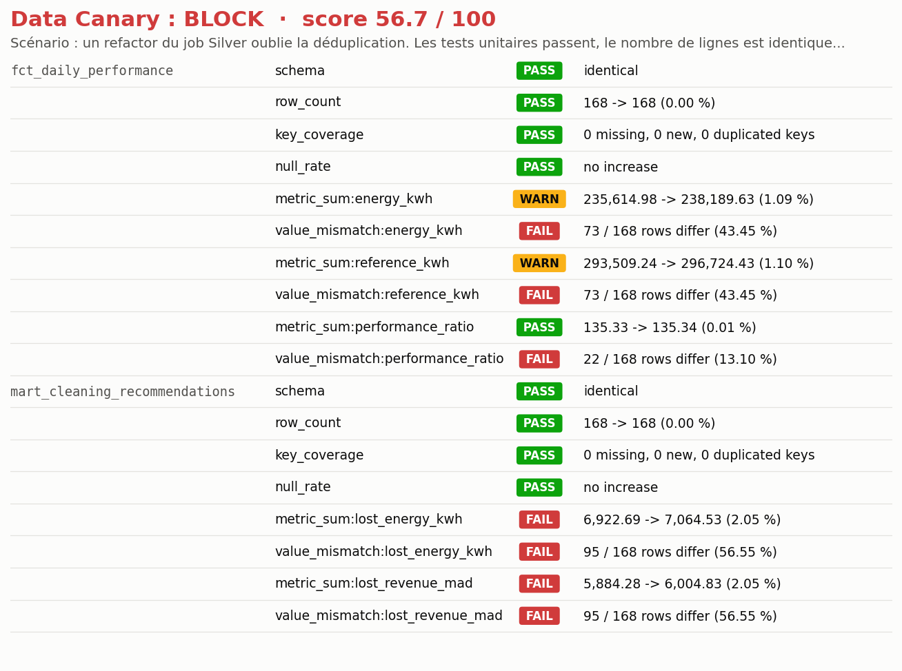
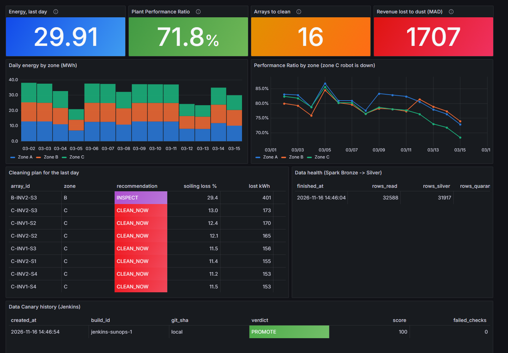
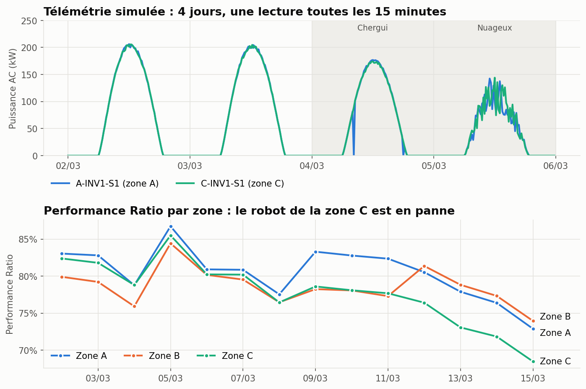
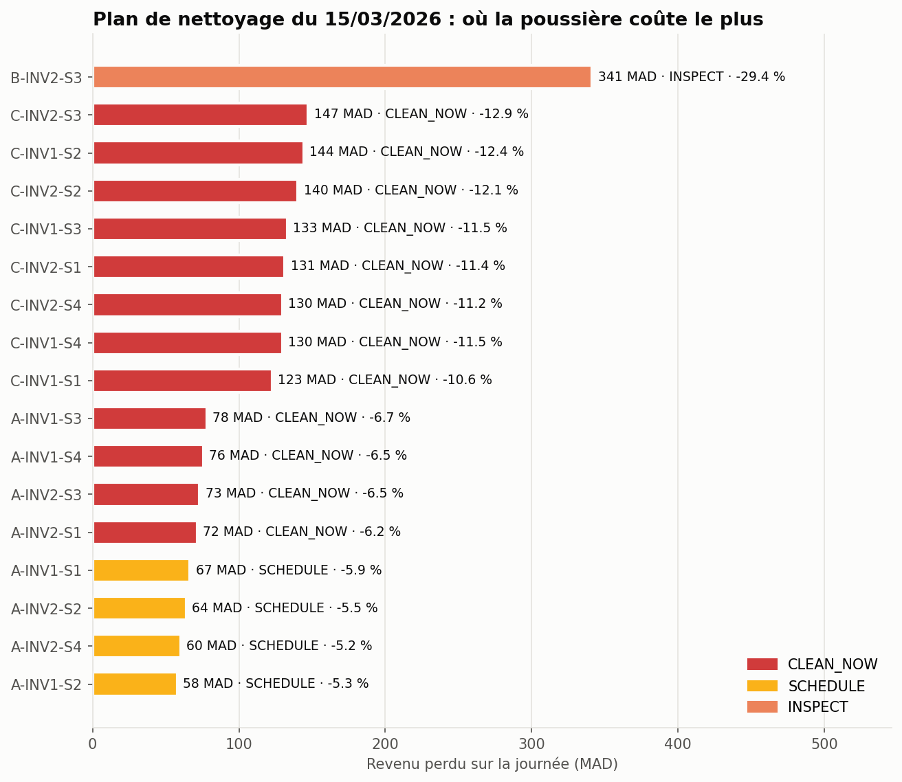

# ☀️ SunOps · DataOps pour une centrale solaire, déployé par Jenkins derrière un *Data Canary*

[](https://github.com/amine-LabsCraft/AWS-Jenkins-Pipeline/actions/workflows/ci.yml)


Un pipeline de données complet, du capteur au tableau de bord, pour **OZZ-1**, une centrale
photovoltaïque fictive de 6 MWc près de **Ouarzazate**. Les panneaux envoient une mesure toutes
les 15 minutes ; le pipeline les nettoie, calcule la performance de chaque panneau et décide
**lesquels les robots doivent nettoyer**, et combien la poussière coûte en dirhams.

Le vrai sujet du projet, c'est la façon dont il est livré. Jenkins ne se contente pas de tester le
code : avant chaque déploiement, il **exécute l'ancienne et la nouvelle version du pipeline sur
les mêmes données et compare ce qu'elles produisent**. Si les chiffres bougent sans raison, le
déploiement est bloqué.

---

## 💡 L'idée : le Data Canary

> Les tests unitaires vérifient que le code fait ce que son auteur pense.
> Le Data Canary vérifie que **les données** n'ont pas changé sans qu'on le veuille.

Un bug de données classique : un refactor du job Spark supprime par erreur le dédoublonnage. Le
code compile, les tests unitaires passent, le nombre de lignes de la table finale est identique.
Pourtant l'énergie produite est gonflée de 1 % et les pertes calculées de 2 %. Personne ne le voit
avant que le directeur de la centrale ne compare avec la facture.

Le Data Canary attrape ce genre de bug avant la production :


1. Un **échantillon doré** est généré de façon déterministe (seed 42, 7 jours, 16 303 lectures,
   dont 175 doublons et 147 lignes corrompues volontairement).
2. Jenkins exécute **le code de `main`** (baseline) et **le code de la branche** (candidate) sur
   cet échantillon, chacun dans ses propres schémas PostgreSQL.
3. `sunops.canary` compare les tables Gold : schéma, nombre de lignes, couverture des clés, taux
   de NULL, somme des métriques et écarts ligne à ligne.
4. Chaque contrôle vaut PASS / WARN / FAIL. Score ≥ 85 et aucun FAIL : **PROMOTE**. Sinon :
   **BLOCK**, build rouge et rapport HTML publié dans Jenkins.

Voici le rapport produit pour le bug du dédoublonnage oublié. Les lignes sont identiques, mais
43 % des valeurs d'énergie ont bougé :



Ce rapport a été reproduit dans les conditions de Jenkins (`scripts/canary.sh`, Spark + dbt +
PostgreSQL) en retirant le dédoublonnage du job Spark sur une branche : verdict BLOCK, avec les
mêmes chiffres que la démo hors-ligne. Dans ce cas précis, le test dbt `unique(event_id)` sur la
couche Silver échoue lui aussi. Le canary ajoute ce que ce test ne dit pas : **l'impact chiffré sur
les tables que lisent les utilisateurs**. Pour un bug sans doublon (unité, colonne renommée,
règle métier modifiée), c'est lui seul qui bloque.

Les seuils sont dans [`canary/thresholds.yml`](canary/thresholds.yml). Chaque exécution est
historisée dans `ops.canary_runs` et affichée dans Grafana, ce qui permet de suivre la qualité des
déploiements dans le temps.

---

## 🏗️ Architecture


| Couche | Outil | Rôle |
|---|---|---|
| Source | Python ([`sunops/generator.py`](sunops/generator.py)) | Simule la télémétrie : courbe solaire, jours de **Chergui** (vent chaud et poussiéreux), tempêtes de sable, encrassement progressif, panne électrique, et données sales (doublons, NULL, capteur bloqué à 9999 °C, panneau inconnu) |
| Bronze | S3 / dossier `lake/` | JSON brut, partitionné par jour d'ingestion |
| Silver | **Spark** ([`spark_jobs/bronze_to_silver.py`](spark_jobs/bronze_to_silver.py)) | Règles générées **depuis le contrat YAML**, lignes invalides mises en quarantaine avec leur motif, dédoublonnage par clé primaire, Parquet partitionné |
| Chargement | Python + SQLAlchemy | Silver → PostgreSQL, idempotent (les jours rechargés sont remplacés) |
| Gold | **dbt** ([`dbt/models`](dbt/models)) | Faits horaires et journaliers, Performance Ratio, recommandations de nettoyage, tests dbt |
| Orchestration | **Airflow** ([`airflow/dags`](airflow/dags/sunops_daily.py)) | DAG quotidien, chaque tâche lance l'image Docker approuvée par Jenkins |
| CI/CD | **Jenkins** ([`Jenkinsfile`](Jenkinsfile)) | Lint, tests, compatibilité du contrat, Data Canary, plan Terraform, validation, déploiement |
| Cloud | **Terraform** ([`infra/terraform`](infra/terraform)) | S3 (lake + artefacts, cycle de vie vers Glacier), ECR, EMR Serverless, IAM à privilèges minimaux |
| Restitution | **Grafana** (+ Power BI possible sur le même schéma) | Production, Performance Ratio, plan de nettoyage, santé des données, historique du canary |

---

## 📊 Ce que le pipeline produit

**Le tableau de bord Grafana**, provisionné automatiquement par `docker compose up`, après un run
complet (14 jours, 32 588 lectures, 345 en quarantaine, 326 doublons supprimés, `dbt build` 30/30) :



**La télémétrie et ce qu'elle raconte.** Les jours de Chergui, la chaleur fait baisser le
rendement des panneaux. La zone C, dont le robot de nettoyage est en panne, perd du terrain jour
après jour :



**Le plan de nettoyage.** Le mart `mart_cleaning_recommendations` compare chaque panneau au
meilleur panneau du même jour (même météo, donc l'écart vient de la saleté). Il chiffre la perte en
kWh et en MAD, puis décide : `CLEAN_NOW`, `SCHEDULE`, `OK`, ou **`INSPECT`** quand la perte vient
d'une panne électrique. Nettoyer un panneau en panne, c'est gaspiller de l'eau dans le désert.



Le 15/03, le pipeline envoie toute la zone C au nettoyage (10 à 13 % de pertes) et B-INV2-S3 en
inspection (29 % de pertes, statut `DEGRADED`).

### Modèle Gold

| Modèle | Grain | Contenu |
|---|---|---|
| `dim_array` | panneau | zone, onduleur, puissance, jour de passage du robot |
| `fct_energy_hourly` | panneau × heure | énergie, rendement de référence, irradiance, température |
| `fct_daily_performance` | panneau × jour | énergie, **Performance Ratio**, disponibilité, part `DEGRADED` |
| `mart_cleaning_recommendations` | panneau × jour | perte par encrassement, kWh et MAD perdus, décision |

Tests dbt : unicité et non-nullité des clés, valeurs acceptées, relations, un test générique
`value_between`, et deux tests métier (`energy ≤ référence`, le panneau en panne n'est jamais
envoyé au nettoyage).

---

## 📜 Le contrat de données

[`contracts/telemetry.yml`](contracts/telemetry.yml) décrit ce que la passerelle IoT s'engage à
envoyer : types, champs obligatoires, plages de valeurs, valeurs autorisées, motifs, clé primaire.
Il est utilisé deux fois :

- **à l'exécution** : le job Spark génère ses règles de validation à partir du contrat ;
- **en CI** : Jenkins compare le contrat de la branche avec celui de `main`. Un changement cassant
  (champ supprimé, type modifié, plage resserrée…) sans montée de version majeure fait échouer le
  build.

```text
$ python -m sunops.contracts compat old.yml contracts/telemetry.yml
  BREAKING      field 'status' removed
  ERROR         1 breaking change(s) need a major version bump (currently 1.0.0 -> 1.1.0)
[contract] FAILED
```

---

## 🚀 Lancer le projet

### 1. Démo du Data Canary, sans Docker (10 secondes)

```bash
pip install pandas pyyaml pytest
python -m sunops.demo --scenario lost-dedup
```

Quatre scénarios : `lost-dedup` (dédoublonnage oublié), `unit-bug` (énergie calculée par heure
au lieu de par quart d'heure), `renamed-column` (colonne renommée qui casserait les dashboards) et
`safe-refactor` (le code change, les données non : PROMOTE). Le rapport HTML est écrit dans
`reports/demo/report/index.html`.

### 2. Plateforme complète en local

```bash
docker compose up --build
```

Cette commande démarre PostgreSQL et Grafana, puis exécute le pipeline : 14 jours générés → Spark → chargement →
`dbt build`. Ensuite, ouvrir **http://localhost:3000** (admin / sunops).

```bash
docker compose run --rm pipeline
```

Relance le pipeline seul (`DAYS=30 docker compose run --rm pipeline` pour plus d'historique).

### 3. Airflow et Jenkins

```bash
docker compose --profile airflow up -d
```

Airflow sur **http://localhost:8081**. Le mot de passe admin s'affiche dans les logs du conteneur
(`airflow standalone`). Le DAG `sunops_daily` est en pause par défaut.

```bash
docker compose --profile ci up -d --build
```

Jenkins sur **http://localhost:8080** (admin / sunops). Un job multibranche `sunops` est créé au
démarrage par Configuration as Code et suit le dépôt défini dans `SUNOPS_REPO_URL`.

### 4. Tests

```bash
pytest -q
```

39 tests, plus le test du job Spark qui ne s'exécute que là où `pyspark` est installé (image
Docker, Jenkins, GitHub Actions).

---

## ☁️ Déployer sur AWS

1. Créer dans Jenkins un credential AWS nommé **`aws-sunops`** et lui attacher la politique
   produite par Terraform (`jenkins_policy_arn`).
2. Pousser sur `main`. Jenkins enchaîne les quality gates, le Data Canary et `terraform plan`
   (archivé dans le build), puis attend une **validation manuelle**.
3. Après validation : `terraform apply`, image poussée sur **ECR**, job Spark, contrat, projet dbt
   et DAG publiés sur S3 ([`scripts/deploy_aws.sh`](scripts/deploy_aws.sh)).

En production, le job Spark tourne sur **EMR Serverless** (`--lake s3://<bucket>`), le DAG sur
**MWAA** (ou tout Airflow qui synchronise depuis S3), et PostgreSQL sur RDS. Région par défaut :
`eu-west-3` (Paris), la plus proche du Maroc. Pour travailler à plusieurs, activer le backend
S3 de Terraform (commenté dans `main.tf`).

---

## 🗂️ Structure

```text
.
├── Jenkinsfile                  # CI/CD : quality gates → Data Canary → plan → approbation → deploy
├── docker-compose.yml           # Postgres, pipeline, Grafana (+ profils airflow, ci)
├── Dockerfile                   # une seule image pour toutes les étapes
├── sunops/
│   ├── generator.py             # simulateur de télémétrie (Bronze)
│   ├── contracts.py             # validation + détection des changements cassants
│   ├── canary.py                # le Data Canary
│   ├── reference.py             # implémentation pandas de référence (démo + tests)
│   ├── load.py · db.py          # chargement Silver → Postgres, utilitaires
│   └── demo.py                  # démo hors-ligne des 4 scénarios
├── spark_jobs/bronze_to_silver.py
├── contracts/telemetry.yml
├── canary/thresholds.yml
├── dbt/                         # staging → intermediate → marts, seeds, tests
├── airflow/dags/sunops_daily.py
├── infra/terraform/             # S3, ECR, EMR Serverless, IAM
├── grafana/                     # datasource + dashboard provisionnés
├── ci/jenkins/                  # image Jenkins + Configuration as Code
├── scripts/                     # run_pipeline.sh, canary.sh, deploy_aws.sh, make_readme_assets.py
└── tests/
```

---

## 🧭 Choix techniques

- **Une seule image Docker** pour le générateur, Spark, dbt et le canary : Jenkins, Airflow et le
  poste local exécutent exactement le même code.
- **Le contrat pilote la validation** : une règle n'existe qu'à un seul endroit, versionnée et
  revue comme du code.
- **Quarantaine plutôt que suppression** : une ligne rejetée garde la liste des règles cassées,
  et le run échoue si la quarantaine dépasse 5 %.
- **Comparer au meilleur panneau du jour** plutôt qu'à une valeur théorique : la météo touche tous
  les panneaux de la même façon, l'écart restant vient de la saleté.
- **Un échantillon doré déterministe** pour le canary : deux exécutions du même code donnent
  exactement les mêmes chiffres, donc tout écart vient du changement testé.
- **Implémentation pandas de référence** : elle reproduit les règles de Spark et de dbt pour que
  la démo et les tests tournent en quelques secondes, sans infrastructure.

## 🔭 Pistes

- Brancher une vraie source (API météo + données ouvertes de production) à la place du simulateur.
- Rendre le Data Canary incrémental pour les gros volumes (échantillonnage par partitions).
- Publier le rapport du canary en commentaire de la pull request.
- Ajouter un modèle de prévision de l'encrassement pour planifier les robots à l'avance.

---

### Origine du dépôt

Ce dépôt était au départ un tutoriel Jenkins + AWS CodeBuild + CodeDeploy qui déployait une page
Flask. Il garde l'idée de départ (Jenkins pilote le déploiement sur AWS) et l'applique à un
pipeline de données : ce qu'on déploie ici, ce sont des transformations, et ce qu'on vérifie avant
de les livrer, ce sont des chiffres.

---

**Amine AIT ALI** · Élève-ingénieur Data & IA, ENSA Khouribga
[Portfolio](https://amine-aitali-5752.netlify.app/) · [GitHub](https://github.com/amine-LabsCraft) · [LinkedIn](https://www.linkedin.com/in/amine-data-engineer)
