# ☀️ SunOps · DataOps pour une centrale solaire, déployé par Jenkins derrière un *Data Canary*

[](https://github.com/amine-LabsCraft/AWS-Jenkins-Pipeline/actions/workflows/ci.yml)


> **Un pipeline de données complet, du capteur au tableau de bord, pour une centrale solaire
> fictive près de Ouarzazate. Avant chaque mise en production, Jenkins compare les données
> produites par l'ancienne et la nouvelle version du code, et bloque si les chiffres ont bougé
> sans raison.**

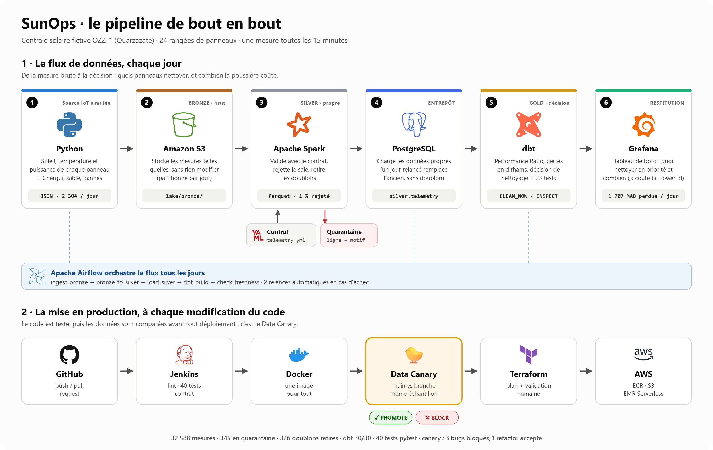

<sub>En haut, le flux de données quotidien (Python → S3 → Spark → PostgreSQL → dbt → Grafana, orchestré par Airflow). En bas, la mise en production (GitHub → Jenkins → Docker → Data Canary → Terraform → AWS). Version vectorielle : [pipeline-overview.svg](docs/images/pipeline-overview.svg).</sub>

---

## Sommaire

1. [En 2 minutes, pour tout le monde](#-en-2-minutes-pour-tout-le-monde)
2. [Le problème métier](#-le-problème-métier)
3. [Vue d'ensemble de l'architecture](#%EF%B8%8F-vue-densemble-de-larchitecture)
4. [Le voyage d'une mesure](#-le-voyage-dune-mesure)
5. [L'idée originale : le Data Canary](#-lidée-originale--le-data-canary)
6. [Le contrat de données](#-le-contrat-de-données)
7. [CI/CD avec Jenkins](#-cicd-avec-jenkins)
8. [Orchestration avec Airflow](#%EF%B8%8F-orchestration-avec-airflow)
9. [Modèle de données Gold](#-modèle-de-données-gold)
10. [Résultats](#-résultats)
11. [Lancer le projet](#-lancer-le-projet)
12. [Déployer sur AWS](#%EF%B8%8F-déployer-sur-aws)
13. [Qualité et tests](#-qualité-et-tests)
14. [Structure du dépôt](#%EF%B8%8F-structure-du-dépôt)
15. [Choix techniques](#-choix-techniques)
16. [Limites et pistes](#-limites-et-pistes)
17. [Glossaire](#-glossaire)
18. [FAQ](#-faq)

---

## 👋 En 2 minutes, pour tout le monde

**Le contexte.** Une centrale solaire, ce sont des milliers de panneaux posés en plein désert. Le
sable et la poussière se déposent dessus et leur font perdre de l'électricité, donc de l'argent.
Des robots peuvent les nettoyer, mais chaque passage coûte du temps et parfois de l'eau, une
ressource rare à Ouarzazate. Il faut donc savoir **quels panneaux nettoyer en priorité**.

**Ce que fait le projet.** Chaque panneau envoie une mesure toutes les 15 minutes (soleil reçu,
température, électricité produite). Le projet :

1. **récupère** ces mesures ;
2. **les nettoie** (doublons, valeurs absurdes, capteurs en panne) ;
3. **calcule** pour chaque panneau combien il produit par rapport à ce qu'il devrait produire ;
4. **recommande** chaque jour quels panneaux nettoyer, lesquels faire inspecter, et combien la
   poussière coûte en dirhams ;
5. **affiche** tout ça dans un tableau de bord.

**L'idée originale : le « Data Canary ».** Autrefois, les mineurs descendaient un canari dans
la mine : s'il se sentait mal, c'était le signal d'un danger invisible. Ici, c'est pareil pour le
code. Quand un développeur modifie le pipeline, on fait tourner **l'ancienne et la nouvelle
version sur exactement les mêmes données**, puis on compare les résultats. Si les chiffres
changent alors que personne ne l'a voulu (énergie gonflée de 1 %, colonne disparue…), la mise en
production est **bloquée automatiquement**, avant que l'erreur n'arrive dans les rapports.

| En une phrase | Pour qui |
|---|---|
| Un tableau de bord qui dit chaque matin quels panneaux nettoyer et combien la poussière coûte | Exploitation de la centrale |
| Un pipeline Medallion Spark + dbt, orchestré par Airflow, testé à chaque niveau | Data engineers |
| Une CI/CD Jenkins qui teste **les données** en plus du code, puis déploie sur AWS avec Terraform | DevOps / plateformes data |

---

## 🎯 Le problème métier

### Mesurer la santé d'un panneau : le Performance Ratio

On ne peut pas juger un panneau à sa production brute : un jour nuageux, tous les panneaux
produisent moins. L'indicateur standard du photovoltaïque est le **Performance Ratio (PR)** :

```text
                 énergie réellement produite
PR  =  ─────────────────────────────────────────────────────────
        énergie qu'un panneau parfait produirait avec le même soleil
```

Un panneau propre et en bon état tourne autour de **80 à 85 %** (une partie est toujours perdue en
chaleur et en conversion). En dessous, quelque chose ne va pas.

### Poussière ou panne ? Comparer au meilleur panneau du jour

La météo touche tous les panneaux de la même manière. Si, le même jour, un panneau fait 87 % et
son voisin 76 %, l'écart ne vient pas du soleil : il vient de la **saleté** ou d'une **panne**.
Le projet compare donc chaque panneau au meilleur panneau de la journée :

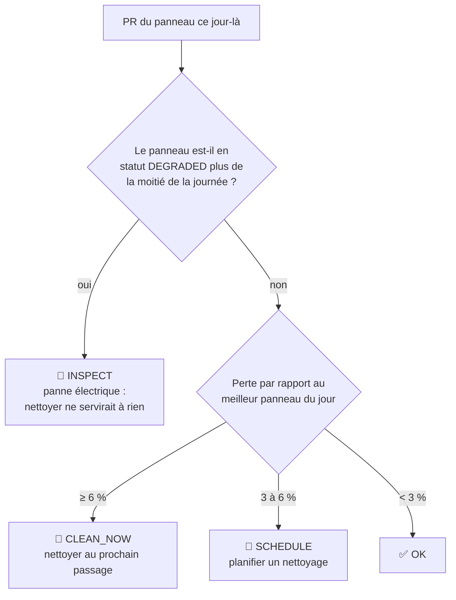

La perte est ensuite **valorisée en dirhams** (0,85 MAD par kWh, paramètre dbt
`tariff_mad_per_kwh`), ce qui permet de prioriser : on nettoie d'abord là où la poussière coûte le
plus.

### Ce que simule la centrale OZZ-1

| Élément | Détail |
|---|---|
| Taille | 3 zones × 2 onduleurs × 4 rangées = **24 rangées de 250 kWc**, soit 6 MWc |
| Fréquence | une mesure par rangée toutes les **15 minutes** (96 par jour, 2 304 pour la centrale) |
| Météo | jours clairs, nuageux, **Chergui** (vent chaud et poussiéreux du Sahara : +9 °C, encrassement ×4), **tempêtes de sable** (irradiance divisée par deux l'après-midi) |
| Robots | zone A nettoyée le lundi, zone B le jeudi, **robot de la zone C en panne** |
| Panne | la rangée **B-INV2-S3** a un défaut électrique (−28 % de production) |
| Données sales | ~1 % de doublons et ~1 % de lignes corrompues (valeur manquante, puissance négative, capteur bloqué à 9 999 °C, rangée inconnue) |

Le scénario est conçu pour que le pipeline ait de vraies décisions à prendre. Il doit voir la
zone C se salir jour après jour, et **ne pas** envoyer B-INV2-S3 au nettoyage : cette rangée a une
panne, pas de la poussière.

---

## 🏗️ Vue d'ensemble de l'architecture

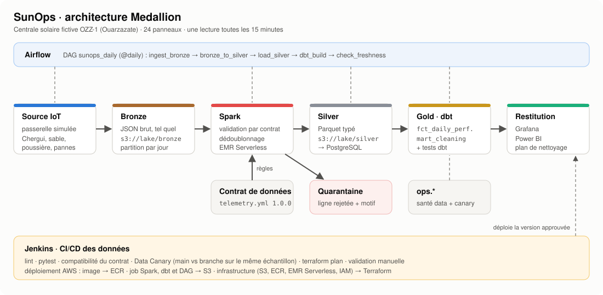

Le pipeline suit l'**architecture Medallion**, comme une raffinerie : le minerai brut (Bronze)
est purifié (Silver), puis transformé en produits finis (Gold).

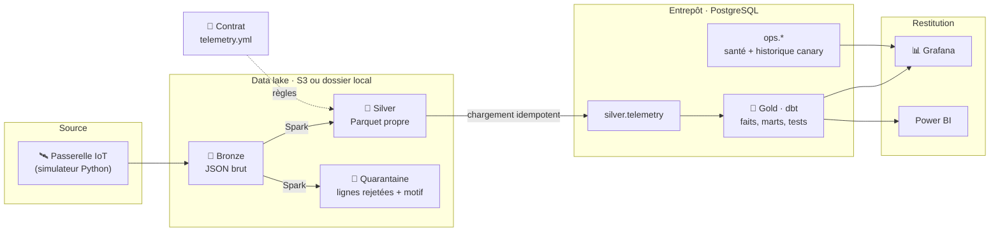

| Couche | Outil | Ce qu'elle fait | Code |
|---|---|---|---|
| Source | Python | Simule la télémétrie (physique simple mais réaliste) | [`sunops/generator.py`](sunops/generator.py) |
| Bronze | S3 / `lake/` | Stocke le JSON tel quel, partitionné par jour : on ne perd jamais l'original | `lake/bronze/` |
| Silver | **Spark** | Valide chaque ligne avec les règles du contrat, met en quarantaine, dédoublonne, type, écrit en Parquet | [`spark_jobs/bronze_to_silver.py`](spark_jobs/bronze_to_silver.py) |
| Chargement | Python + SQLAlchemy | Copie Silver dans PostgreSQL ; un jour rechargé remplace l'ancien (idempotent) | [`sunops/load.py`](sunops/load.py) |
| Gold | **dbt** | Calcule énergie, PR, recommandations ; 23 tests de données | [`dbt/models`](dbt/models) |
| Orchestration | **Airflow** | Lance chaque étape tous les jours dans l'image Docker approuvée | [`airflow/dags`](airflow/dags/sunops_daily.py) |
| CI/CD | **Jenkins** | Lint, tests, contrat, Data Canary, Terraform, validation, déploiement | [`Jenkinsfile`](Jenkinsfile) |
| Cloud | **Terraform** | S3, ECR, EMR Serverless, IAM | [`infra/terraform`](infra/terraform) |
| Restitution | **Grafana** | Dashboard provisionné automatiquement | [`grafana/`](grafana) |

---

## 🧭 Le voyage d'une mesure

Suivons une vraie mesure, produite par la rangée **C-INV1-S2** le 15 mars à 12 h 15.

**1. Bronze : la mesure brute, telle que la passerelle l'envoie**

```json
{
  "event_id": "C-INV1-S2-202603151215",
  "plant_id": "OZZ-1", "zone": "C", "inverter_id": "C-INV1", "array_id": "C-INV1-S2",
  "ts": "2026-03-15T12:15:00Z",
  "irradiance_wm2": 933.43, "ambient_temp_c": 33.77, "module_temp_c": 64.11,
  "dc_voltage_v": 642.2, "dc_current_a": 243.47, "ac_power_kw": 152.458,
  "status": "OK", "ingested_at": "2026-03-15T12:18:41Z"
}
```

**2. Silver : Spark vérifie la mesure contre le contrat.** Chaque champ a ses règles (type,
obligatoire, plage, valeurs permises, format). Celle-ci est valide et passe. Une autre, envoyée
par un capteur bloqué, est rejetée :

```json
{"array_id": "C-INV2-S2", "ts": "2026-03-02T06:45:00Z", "module_temp_c": 9999.0, "...": "...",
 "_errors": ["module_temp_c:max"]}
```

Elle part en **quarantaine** avec la règle cassée. Rien n'est supprimé en silence : on peut
toujours analyser et rejouer ces lignes. Si la passerelle a envoyé deux fois la même mesure, Spark
garde la copie la plus récente (clé primaire `array_id + ts`).

**3. Gold : dbt agrège la journée.** Les 96 mesures de la journée deviennent une ligne de
`fct_daily_performance`, puis une décision dans `mart_cleaning_recommendations` :

| Champ | Valeur | Lecture |
|---|---|---|
| `energy_kwh` | 1 197 kWh | ce que la rangée a produit |
| `reference_kwh` | 1 763 kWh | ce qu'une rangée parfaite aurait produit |
| `performance_ratio` | 67,9 % | 1 197 / 1 763 |
| `relative_pr` | 87,6 % | comparée à la meilleure rangée du jour |
| `soiling_loss_pct` | **12,4 %** | perte attribuée à la poussière |
| `lost_energy_kwh` | 170 kWh | énergie perdue |
| `lost_revenue_mad` | **144 MAD** | ce que la poussière a coûté ce jour-là |
| `recommendation` | **CLEAN_NOW** | le robot de la zone C est en panne, ça se voit |

**4. Restitution :** la ligne apparaît dans le tableau « Cleaning plan » de Grafana.

---

## 💡 L'idée originale : le Data Canary

### Le problème qu'il résout

> Les tests unitaires vérifient que le code fait ce que son auteur pense.
> Le Data Canary vérifie que **les données** n'ont pas changé sans qu'on le veuille.

Exemple réel testé dans ce projet : un développeur « simplifie » le job Spark et supprime par
erreur le dédoublonnage. Le code tourne, les tests unitaires passent, la table finale a toujours
168 lignes. Pourtant l'énergie est gonflée de 1,1 % et les pertes calculées de 2 %. Sans canary,
personne ne le voit avant de comparer avec la facture d'électricité.

### Comment il fonctionne

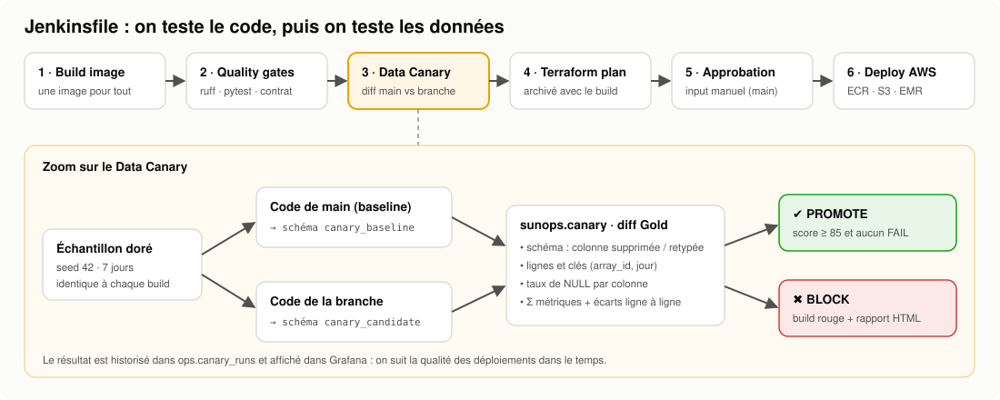

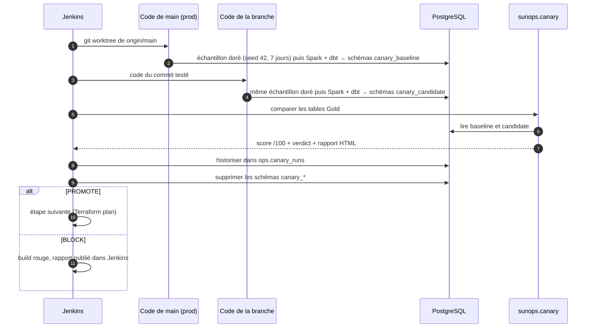

Pourquoi un **échantillon doré** ? Il est généré avec une graine fixe : deux exécutions du même
code donnent exactement les mêmes chiffres. Tout écart vient donc forcément du changement testé.

### Les contrôles

| Contrôle | Question posée | FAIL si… |
|---|---|---|
| `schema` | des colonnes ont-elles disparu ou changé de type ? | colonne supprimée ou retypée (ajout = WARN) |
| `row_count` | a-t-on gagné ou perdu des lignes ? | écart > 2 % |
| `key_coverage` | chaque (rangée, jour) existe-t-il des deux côtés, une seule fois ? | > 0,5 % de clés manquantes, ou doublons |
| `null_rate` | des valeurs vides sont-elles apparues ? | + 2 points sur une colonne |
| `metric_sum` | le total de chaque métrique a-t-il dérivé ? | écart > 2 % |
| `value_mismatch` | ligne par ligne, combien de valeurs ont bougé ? | > 5 % des lignes au-delà de 0,1 % |

Chaque contrôle donne PASS (100 points), WARN (60) ou FAIL (0). Le **score** est la moyenne.
Verdict **PROMOTE** si aucun FAIL et score ≥ 85, sinon **BLOCK**. Tous les seuils sont dans
[`canary/thresholds.yml`](canary/thresholds.yml).

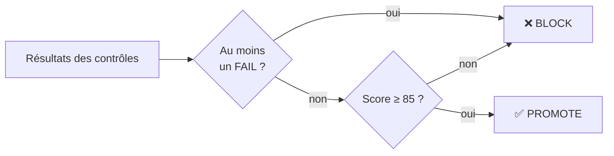

### Résultats sur 4 scénarios

| Scénario | Ce qui change | Score | Verdict |
|---|---|---|---|
| `safe-refactor` | le code change, pas les données | 100 | ✅ PROMOTE |
| `lost-dedup` | le dédoublonnage est oublié | 56,7 | ❌ BLOCK (7 FAIL, 2 WARN) |
| `unit-bug` | énergie calculée par heure au lieu de par quart d'heure (×4) | 55,6 | ❌ BLOCK (8 FAIL) |
| `renamed-column` | `performance_ratio` renommée en `pr` | 93,8 | ❌ BLOCK (le schéma FAIL suffit) |

Le cas `renamed-column` montre pourquoi la règle « aucun FAIL » existe : le score est élevé (tout
le reste est identique), mais une colonne renommée casserait tous les dashboards.

Voici le rapport pour `lost-dedup`. Le nombre de lignes est identique, mais 43 % des valeurs
d'énergie ont bougé :


Ce bug a aussi été reproduit dans les vraies conditions de Jenkins (`scripts/canary.sh` avec Spark,
dbt et PostgreSQL), sur une branche qui retire le dédoublonnage du job Spark : **BLOCK**, avec les
mêmes chiffres que la démo. Dans ce cas précis, le test dbt `unique(event_id)` échoue lui aussi.
Le canary ajoute l'**impact chiffré** sur les tables que lisent les utilisateurs, et c'est lui seul
qui bloque les bugs sans doublon (unité, colonne renommée, règle métier modifiée).

---

## 📜 Le contrat de données

Un **contrat de données**, c'est l'accord écrit entre celui qui envoie les données (la passerelle
IoT) et ceux qui les utilisent (le pipeline, les analystes). Il dit précisément ce qui est
garanti. Ici : [`contracts/telemetry.yml`](contracts/telemetry.yml).

```yaml
contract: solar_telemetry
version: 1.0.0
primary_key: [array_id, ts]
fields:
  array_id:       {type: string, required: true, pattern: '^[ABC]-INV[0-9]-S[0-9]$'}
  irradiance_wm2: {type: float,  required: true, min: 0, max: 1500}
  module_temp_c:  {type: float,  required: true, min: -20, max: 95}
  ac_power_kw:    {type: float,  required: true, min: 0, max: 300}
  status:         {type: string, required: true, allowed: [OK, DEGRADED, OFFLINE]}
  # ...
```

Il sert à deux endroits :

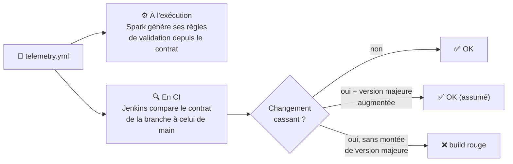

| Changement | Cassant ? | Pourquoi |
|---|---|---|
| Supprimer un champ, changer son type | oui | les consommateurs le lisent |
| Rendre un champ obligatoire, ajouter un champ obligatoire | oui | les producteurs actuels ne l'envoient pas |
| Resserrer une plage (`max: 300 → 280`), retirer une valeur permise | oui | des données valides hier deviennent invalides |
| Changer la clé primaire ou un format (`pattern`) | oui | le dédoublonnage et les jointures changent |
| Ajouter un champ optionnel, élargir une plage, ajouter une valeur permise | non | rien d'existant ne casse |

```text
$ python -m sunops.contracts compat old.yml contracts/telemetry.yml
  BREAKING      field 'status' removed
  ERROR         1 breaking change(s) need a major version bump (currently 1.0.0 -> 1.1.0)
[contract] FAILED
```

Répartition réelle des rejets sur 14 jours de données (345 lignes en quarantaine sur 32 588) :

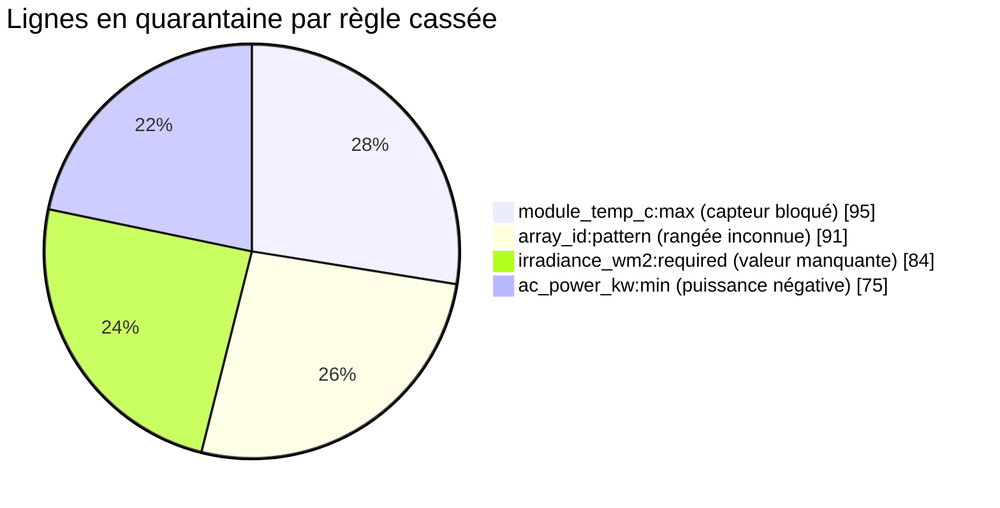

---

## 🔁 CI/CD avec Jenkins

Le [`Jenkinsfile`](Jenkinsfile) s'exécute à chaque push. Les branches s'arrêtent après le Data
Canary ; seule `main` (ou un hotfix forcé) va jusqu'au déploiement, avec une validation humaine.

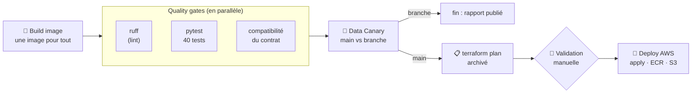

| Étape | Outil | Bloque si… |
|---|---|---|
| Build image | Docker | le Dockerfile ou les dépendances ne s'installent pas |
| Lint | ruff | erreur de style ou bug évident (import inutile, variable non définie…) |
| Unit tests | pytest + couverture | un test échoue (rapport JUnit dans Jenkins) |
| Data contract | `sunops.contracts compat` | changement cassant sans version majeure |
| Data Canary | `scripts/canary.sh` | les données Gold ont bougé au-delà des seuils |
| Terraform plan | `hashicorp/terraform` | l'infrastructure ne se planifie pas |
| Approbation | `input` Jenkins | un humain refuse (2 h max) |
| Deploy | Terraform + AWS CLI | échec du push ECR ou de la publication S3 |

Après chaque build, Jenkins publie le **rapport HTML du canary**, les résultats de tests, le plan
Terraform et met le score dans la description du build (`Canary PROMOTE · 100/100`).

Un workflow **GitHub Actions** ([`.github/workflows/ci.yml`](.github/workflows/ci.yml)) rejoue les
quality gates et la démo du canary à chaque push, pour le badge du README.

---

## ⏱️ Orchestration avec Airflow

Le DAG [`sunops_daily`](airflow/dags/sunops_daily.py) tourne une fois par jour. Chaque tâche
démarre l'image Docker que Jenkins a construite et que le canary a validée : Airflow planifie, il ne
contient aucune logique métier.

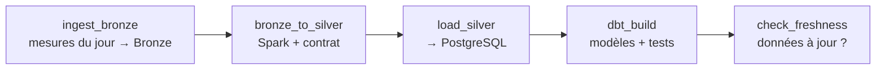

Réglages : 2 nouvelles tentatives avec attente exponentielle, un seul run à la fois, pas de
rattrapage automatique. En production, la même logique tourne sur **MWAA**, avec le job Spark sur
**EMR Serverless**.

---

## 🧱 Modèle de données Gold

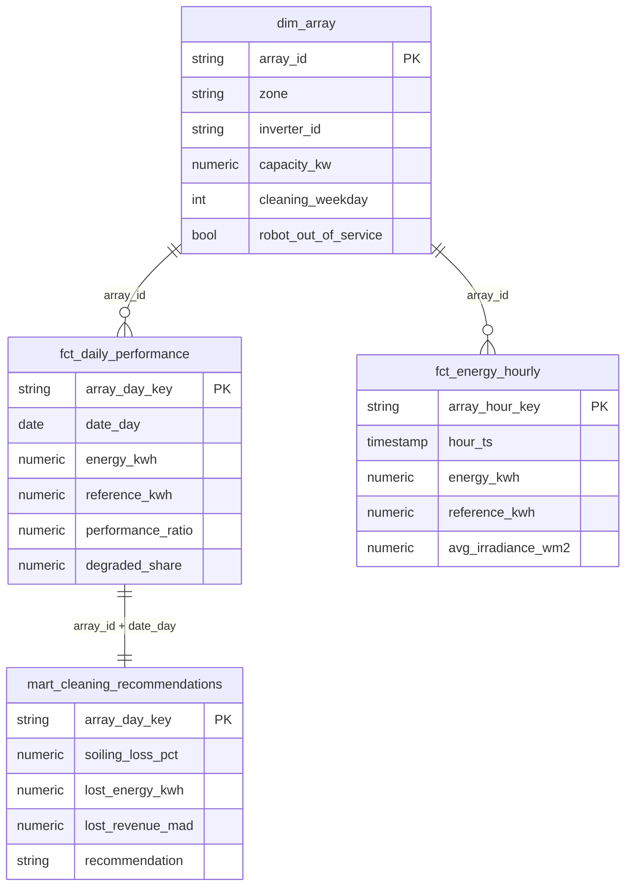

Lignée dbt (staging → intermediate → marts) :

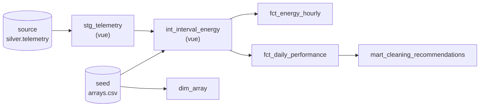

| Modèle | Grain | Lignes (14 jours) |
|---|---|---|
| `dim_array` | une rangée de panneaux | 24 |
| `fct_energy_hourly` | rangée × heure | 8 064 |
| `fct_daily_performance` | rangée × jour | 336 |
| `mart_cleaning_recommendations` | rangée × jour | 336 |

Les paramètres métier (tarif, seuils de nettoyage, seuil d'inspection) sont des `vars` dbt dans
[`dbt_project.yml`](dbt/dbt_project.yml) : on les modifie sans toucher au SQL.

---

## 📊 Résultats

Run complet de 14 jours (2 au 15 mars 2026), exécuté avec `docker compose up` :

| Étape | Résultat |
|---|---|
| Bronze | 32 588 mesures générées |
| Spark | 345 mises en quarantaine (1,06 %), 326 doublons supprimés, 31 917 lignes Silver |
| dbt build | **30/30 PASS** (1 seed, 6 modèles, 23 tests) |
| Dernier jour | 29,9 MWh produits, PR de la centrale 71,8 % (journée de Chergui) |
| Recommandations | 12 `CLEAN_NOW`, 4 `SCHEDULE`, 1 `INSPECT`, 7 `OK` |
| Coût de la poussière | **1 707 MAD** perdus sur la journée (hors rangée en panne) |

**La télémétrie.** Les jours de Chergui, la chaleur fait baisser le rendement. La zone C, dont le
robot est en panne, décroche jour après jour : le 15 mars, son PR est à 68,5 %, contre 72,9 % pour
la zone A et 73,9 % pour la zone B.


**Le plan de nettoyage du 15 mars.** Toute la zone C est à nettoyer (10 à 13 % de pertes).
B-INV2-S3 perd 29 %, mais elle est envoyée en **inspection** : sa perte vient d'une panne, pas de
la poussière.


**Le tableau de bord Grafana.** Tout ce qui précède, en direct, sur http://localhost:3000.


---

## 🚀 Lancer le projet

### Niveau 1 · La démo du Data Canary, sans Docker (10 secondes)

Prérequis : Python 3.10+.

```bash
pip install pandas pyyaml pytest
```

```bash
python -m sunops.demo --scenario lost-dedup
```

Scénarios : `lost-dedup`, `unit-bug`, `renamed-column`, `safe-refactor`. Le rapport HTML est
écrit dans `reports/demo/report/index.html`.

### Niveau 2 · La plateforme complète en local

Prérequis : Docker Desktop (≈ 2 Go d'images au premier lancement).

```bash
docker compose up --build
```

Ce qui se passe :

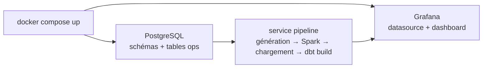

Ensuite, ouvrir **http://localhost:3000** (admin / sunops). Le service `pipeline` s'arrête une
fois son travail terminé ; Postgres et Grafana restent allumés.

```bash
docker compose run --rm pipeline
```

Relance seulement le pipeline (`DAYS=30` pour plus d'historique).

```bash
docker compose down -v
```

Arrête tout et supprime les données.

### Niveau 3 · Airflow et Jenkins

```bash
docker compose --profile airflow up -d
```

Airflow sur **http://localhost:8081** ; le mot de passe admin s'affiche dans les logs du conteneur.
Le DAG `sunops_daily` est en pause par défaut.

```bash
docker compose --profile ci up -d --build
```

Jenkins sur **http://localhost:8080** (admin / sunops). Un job multibranche `sunops` est créé au
démarrage par Configuration as Code et suit ce dépôt.

### Variables utiles

| Variable | Défaut | Rôle |
|---|---|---|
| `DAYS` | 14 | nombre de jours générés |
| `START_DATE` | 2026-03-02 | premier jour |
| `SEED` | 42 | graine du simulateur (mêmes données à chaque run) |
| `CHAOS` | 0.01 | part de lignes sales injectées |
| `RAW_SCHEMA` / `DBT_SCHEMA` | `silver` / `analytics` | schémas cibles (le canary utilise `canary_*`) |
| `SUNOPS_PG_DSN` | Postgres du compose | connexion SQLAlchemy |
| `CANARY_BASE_REF` | `origin/main` | version de référence du canary |

---

## ☁️ Déployer sur AWS

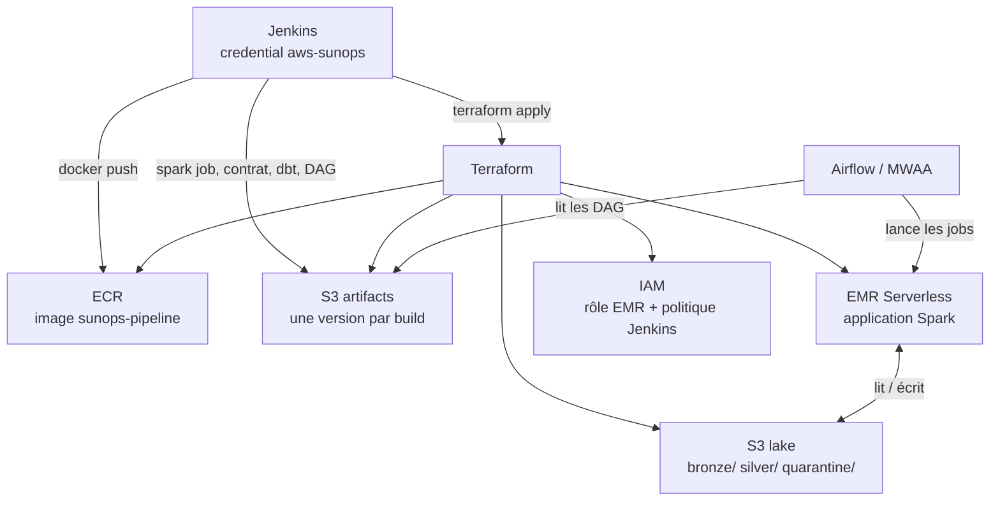

| Ressource | Détail |
|---|---|
| S3 lake | versionné, chiffré, accès public bloqué ; Bronze → IA à 30 j → Glacier à 120 j ; quarantaine supprimée à 30 j |
| S3 artifacts | une version par build : job Spark, contrat, projet dbt, rapport du canary, DAG |
| ECR | scan à chaque push, on garde les 20 dernières images |
| EMR Serverless | Spark à la demande, s'éteint après 10 min d'inactivité |
| IAM | rôle d'exécution EMR limité aux 2 buckets ; politique Jenkins limitée à ECR, S3 artifacts, EMR et `PassRole` |

Étapes :

1. Créer dans Jenkins un credential AWS **`aws-sunops`** et lui attacher la politique
   `jenkins_policy_arn` produite par Terraform.
2. Pousser sur `main` : quality gates → Data Canary → `terraform plan` archivé → **validation**.
3. Après validation : `terraform apply`, puis [`scripts/deploy_aws.sh`](scripts/deploy_aws.sh)
   publie l'image et le code.

Région par défaut : `eu-west-3` (Paris), la plus proche du Maroc. Pour travailler à plusieurs,
activer le backend S3 de Terraform (commenté dans `main.tf`).

---

## ✅ Qualité et tests

La qualité est vérifiée à cinq niveaux, du plus rapide au plus proche de la production :

| Niveau | Outil | Ce qui est vérifié | Quand |
|---|---|---|---|
| 1. Style | ruff | erreurs évidentes, imports | chaque push |
| 2. Logique | pytest (40 tests) | générateur, contrat, canary, règles métier, cohérence seed / plant, job Spark | chaque push |
| 3. Contrat | `sunops.contracts` | 14 champs à chaque ligne ; compatibilité avec `main` | chaque run et chaque push |
| 4. Données | tests dbt (23) | clés uniques, valeurs permises, relations, plages, 2 règles métier | chaque run |
| 5. Impact | Data Canary | différences entre `main` et la branche sur les tables Gold | chaque push dans Jenkins |

Deux tests métier dbt méritent d'être cités :

- [`assert_energy_below_reference`](dbt/tests/assert_energy_below_reference.sql) : une rangée ne
  peut pas produire plus qu'une rangée parfaite sous le même soleil ;
- [`assert_faulty_array_is_inspected`](dbt/tests/assert_faulty_array_is_inspected.sql) : la rangée
  en panne n'est jamais envoyée au nettoyage.

```bash
pytest -q
```

Le test Spark ne s'exécute que là où `pyspark` est installé (image Docker, Jenkins, GitHub
Actions) ; ailleurs, il est ignoré proprement.

---

## 🗂️ Structure du dépôt

```text
.
├── Jenkinsfile                  # CI/CD : quality gates → Data Canary → plan → approbation → deploy
├── docker-compose.yml           # Postgres, pipeline, Grafana (+ profils airflow, ci)
├── Dockerfile                   # une seule image pour toutes les étapes
├── sunops/
│   ├── generator.py             # simulateur de télémétrie (Bronze)
│   ├── plant.py                 # plan de la centrale (zones, robots, rangée en panne)
│   ├── contracts.py             # validation + détection des changements cassants
│   ├── canary.py                # le Data Canary (contrôles, score, rapports)
│   ├── reference.py             # implémentation pandas de référence (démo + tests)
│   ├── load.py · db.py          # chargement Silver → Postgres, utilitaires
│   └── demo.py                  # démo hors-ligne des 4 scénarios
├── spark_jobs/bronze_to_silver.py
├── contracts/telemetry.yml      # contrat de données
├── canary/thresholds.yml        # tables comparées et seuils du canary
├── dbt/                         # staging → intermediate → marts, seed, tests
├── airflow/dags/sunops_daily.py
├── infra/terraform/             # S3, ECR, EMR Serverless, IAM
├── grafana/                     # datasource + dashboard provisionnés
├── ci/jenkins/                  # image Jenkins + Configuration as Code
├── sql/init/                    # schémas et tables ops
├── scripts/                     # run_pipeline.sh, canary.sh, deploy_aws.sh, make_readme_assets.py
├── docs/images/                 # schémas et graphiques du README
└── tests/
```

---

## 🧠 Choix techniques

| Décision | Alternative écartée | Pourquoi |
|---|---|---|
| Une seule image Docker pour toutes les étapes | une image par outil | Jenkins, Airflow et le poste local exécutent exactement le même code |
| Règles de validation générées depuis le contrat YAML | règles codées dans Spark | une règle n'existe qu'à un seul endroit, versionnée et revue comme du code |
| Quarantaine avec motif | suppression des lignes invalides | rien ne disparaît en silence ; le run échoue au-delà de 5 % de rejets |
| Comparer au meilleur panneau du jour | comparer à un modèle théorique | la météo s'annule, l'écart restant vient de la saleté ou d'une panne |
| Échantillon doré déterministe | données de production récentes | deux runs du même code donnent les mêmes chiffres : tout écart vient du changement |
| Seuils du canary dans un fichier YAML | seuils dans le code | ajustables par table sans redéploiement |
| Implémentation pandas de référence | tout en Spark | démo et tests en quelques secondes, sans infrastructure ; un test vérifie que Spark donne le même résultat |
| Chargement idempotent par jour | `append` simple | relancer un jour ne crée jamais de doublons |
| Paramètres métier en `vars` dbt | constantes dans le SQL | tarif et seuils modifiables sans toucher aux modèles |

---

## 🔭 Limites et pistes

**Limites actuelles**

- La source est simulée : la physique est plausible mais simplifiée (pas d'ombrage ni de
  vieillissement des panneaux).
- Le canary compare les tables Gold entières : sur de très gros volumes, il faudra comparer par
  échantillonnage de partitions.
- L'état Terraform est local par défaut : à passer sur S3 + verrou DynamoDB pour une équipe.

**Pistes**

- Brancher une vraie source (API météo + données ouvertes de production).
- Publier le rapport du canary en commentaire de la pull request.
- Prévoir l'encrassement pour planifier les robots à l'avance, et intégrer le coût en eau de
  chaque nettoyage.
- Ajouter des alertes Grafana quand la quarantaine ou la perte en MAD dépasse un seuil.

---

## 📖 Glossaire

| Terme | En clair |
|---|---|
| **Pipeline de données** | une chaîne d'étapes automatiques qui transforme des données brutes en informations utiles |
| **Bronze / Silver / Gold** | données brutes / nettoyées / prêtes pour l'analyse (architecture Medallion) |
| **Performance Ratio (PR)** | production réelle divisée par la production d'un panneau parfait sous le même soleil |
| **Encrassement (soiling)** | poussière et sable déposés sur les panneaux |
| **Chergui** | vent chaud et sec venu du Sahara, qui charge l'air de poussière |
| **Contrat de données** | accord écrit entre producteur et consommateurs : format, règles, version |
| **Quarantaine** | zone où l'on range les lignes invalides, avec la raison du rejet |
| **CI/CD** | tests automatiques à chaque modification du code (CI), puis mise en production automatisée (CD) |
| **Data Canary** | comparaison des données produites par l'ancienne et la nouvelle version avant la mise en production |
| **Idempotent** | relancer l'opération donne le même résultat, sans doublon |
| **Infrastructure as Code** | décrire les serveurs et services cloud dans des fichiers (Terraform) plutôt qu'à la main |
| **MAD** | dirham marocain |

---

## ❓ FAQ

**Les données sont-elles réelles ?**
Non. La centrale OZZ-1 est fictive et les mesures sont simulées, avec une physique plausible et
des défauts volontaires. C'est ce qui permet de tester le pipeline sur des cas connus à l'avance
(zone C sale, rangée en panne, doublons).

**Pourquoi un canary si on a déjà des tests ?**
Les tests vérifient des règles connues à l'avance. Le canary détecte aussi les effets que personne
n'a pensé à tester, en comparant directement les chiffres avant / après.

**Que se passe-t-il au tout premier build, quand `main` n'existe pas encore ?**
Le canary compare la branche à elle-même (PROMOTE) et le contrôle du contrat considère que c'est la
première version.

**Un changement voulu des chiffres (nouvelle règle métier) est-il bloqué ?**
Oui, par conception : le rapport montre l'impact exact, l'équipe le relit, puis ajuste les seuils
de la table concernée dans `canary/thresholds.yml` dans la même pull request. Le changement de
chiffres devient une décision visible dans l'historique Git.

**Peut-on brancher Power BI ?**
Oui : les tables Gold sont dans le schéma `analytics` de PostgreSQL, lisibles par n'importe quel
outil BI.


---

**Amine AIT ALI** · Élève-ingénieur Data & IA, ENSA Khouribga
[Portfolio](https://amine-aitali-5752.netlify.app/) · [GitHub](https://github.com/amine-LabsCraft) · [LinkedIn](https://www.linkedin.com/in/amine-data-engineer)
